<div align="center">


# SkyGuard

**Smart Linux Security Layer & Honeypot System**

*Protect your server by hiding real services, luring attackers into traps, and auto-banning threats — all in a single Go binary.*

---

[](https://go.dev/)
[](https://pkg.go.dev/modernc.org/sqlite)
[](https://www.docker.com/)
[](#license)
[](https://linuxcontainers.org/incus/)

---


-00ADD8?logo=go&logoColor=white)

**[Install](#installation)** · **[Screenshots](#screenshots)** · **[Configuration](#configuration)** · **[Containers](#containers-docker-and-incus)** · **[AI assistants (MCP)](#ai-assistants-mcp)** · **[API](#dashboard--rest-api)** · **[Operations guide](USAGE.md)** · **[Install guide for AI agents](LLM_INSTALL.md)**

</div>

---

## Screenshots

The dashboard on a server under a week of attack traffic, with 96 Docker containers next to it. Every address in these pictures is from the documentation ranges (RFC 5737).

<p align="center">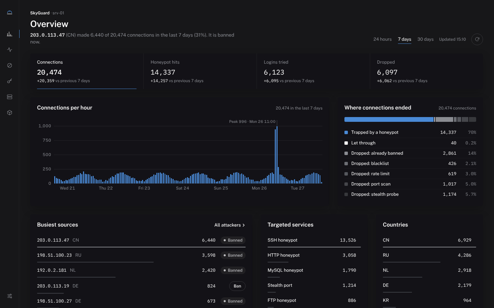</p>

<p align="center">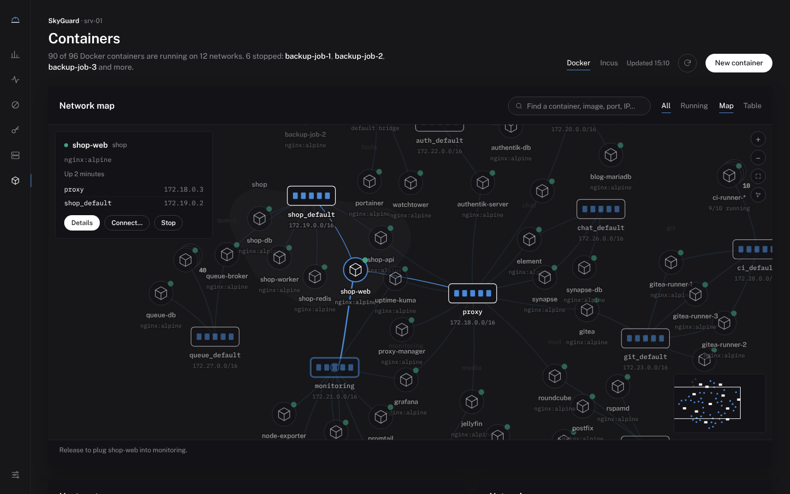</p>

| | |
|---|---|
| 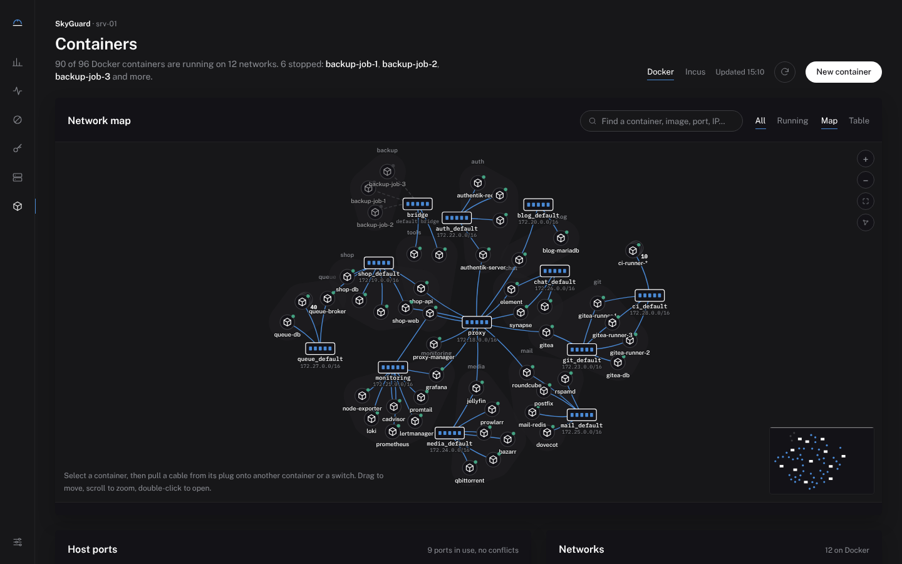 **Network map** — 96 containers, Compose projects kept together, replicas folded, minimap | 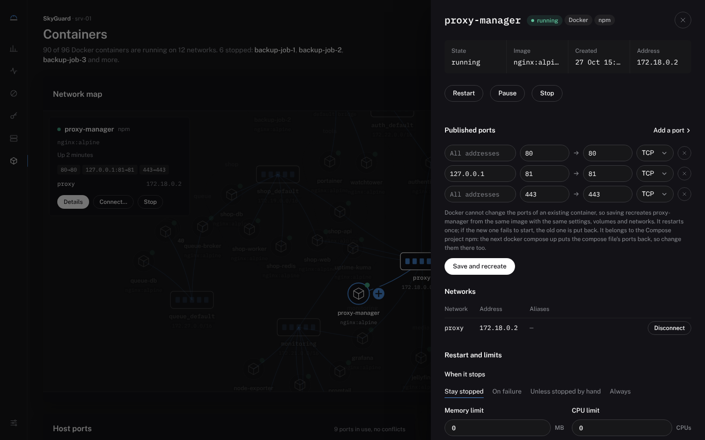 **Container sheet** — ports, networks, restart policy, limits, logs, snapshots |
| 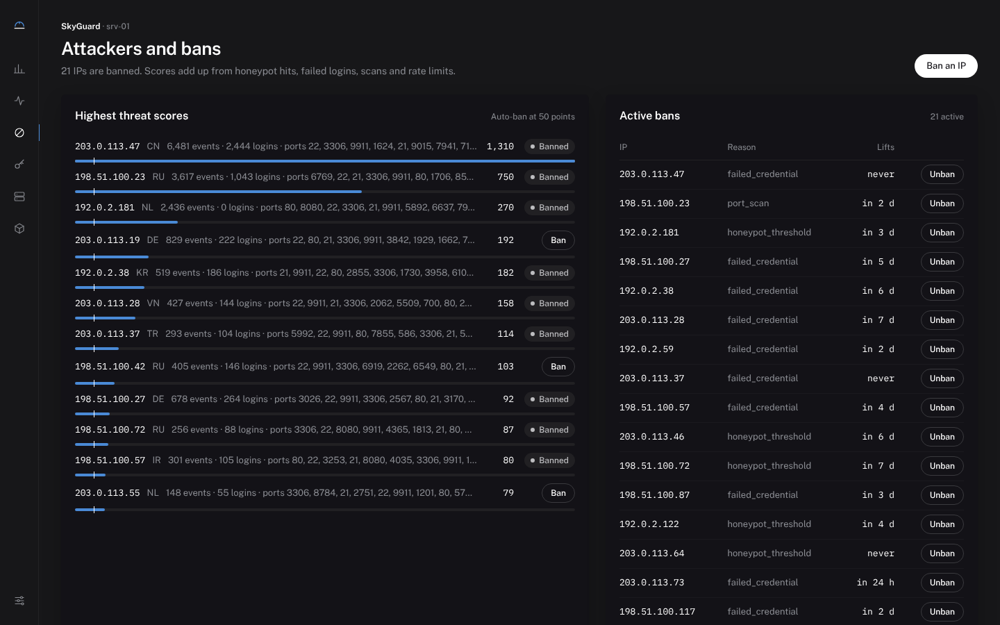 **Attackers and bans** — scores against the auto-ban threshold, active bans | 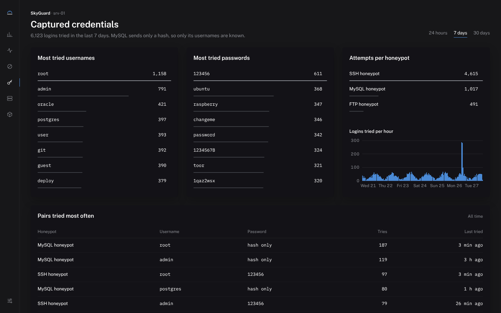 **Captured credentials** — what bots try, per honeypot and over time |
| 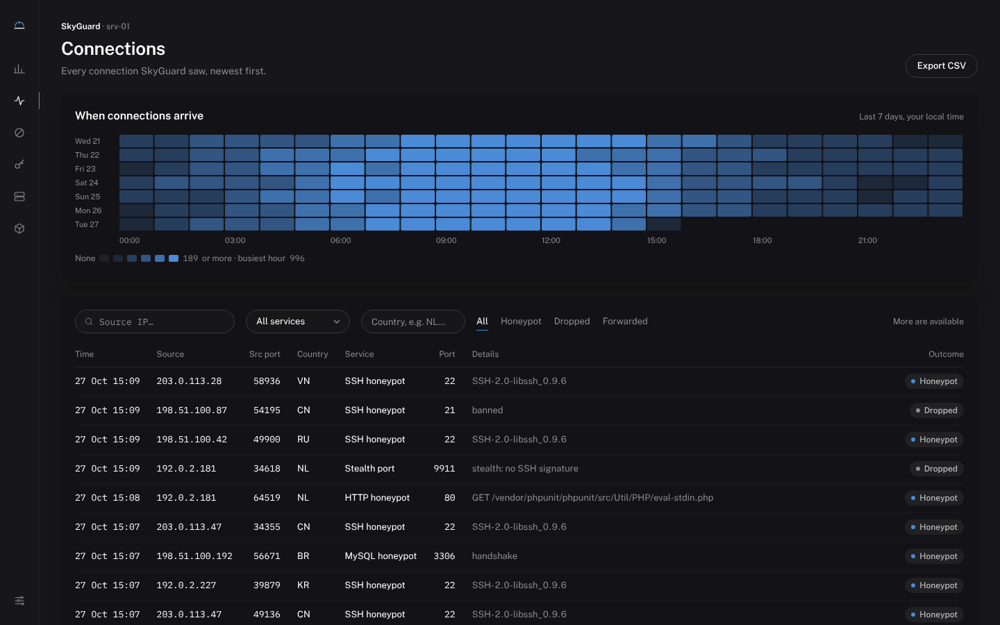 **Connections** — day × hour heatmap and the filterable log | 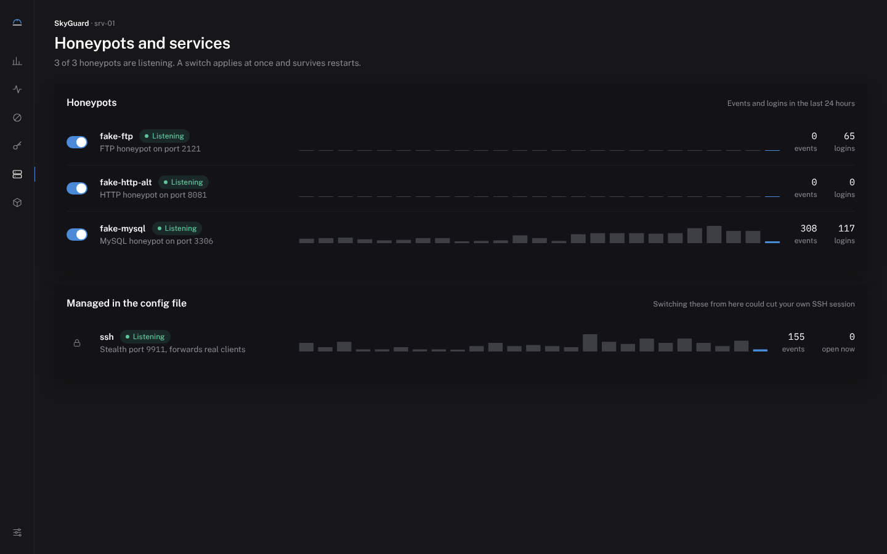 **Honeypots** — switched on and off at runtime |
| 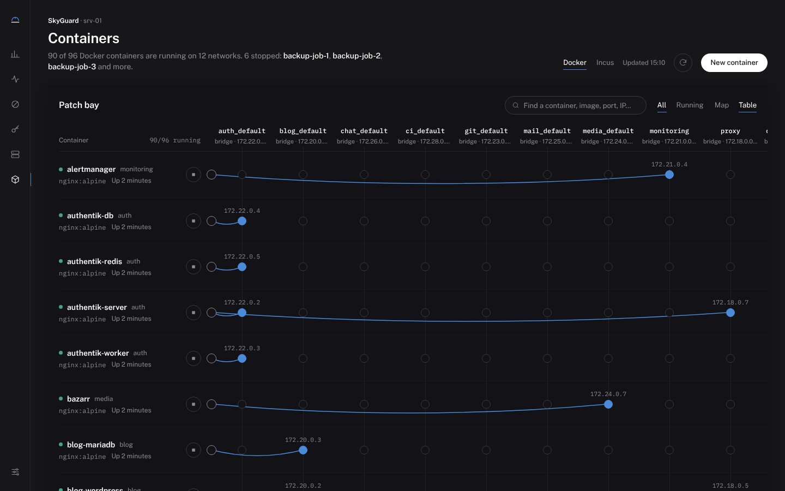 **Table view** — the patch bay for precise work | 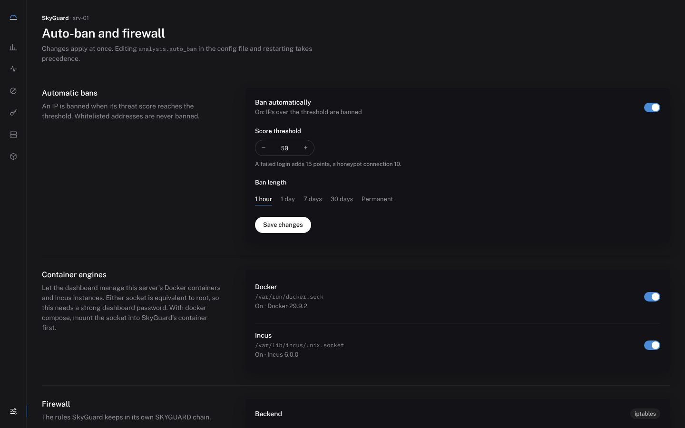 **Settings** — auto-ban, container engines, firewall rules |

<p align="center">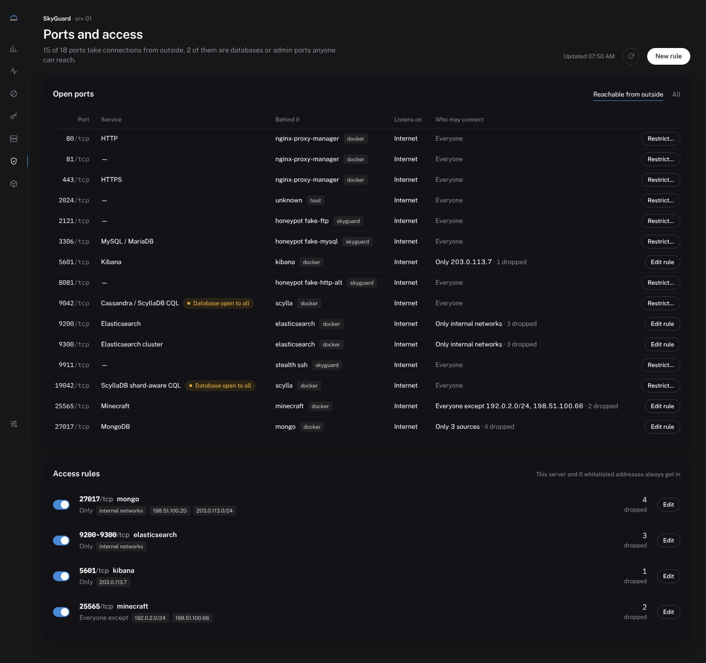</p>

<p align="center">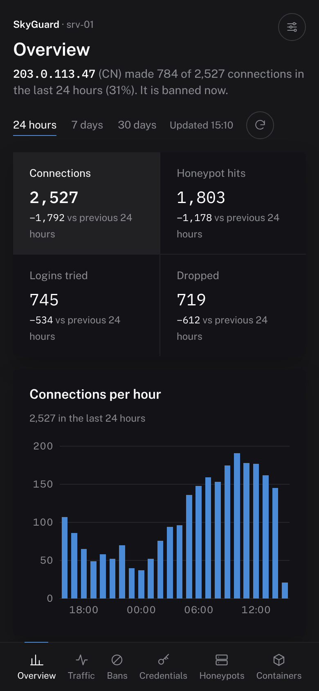&nbsp;&nbsp;&nbsp;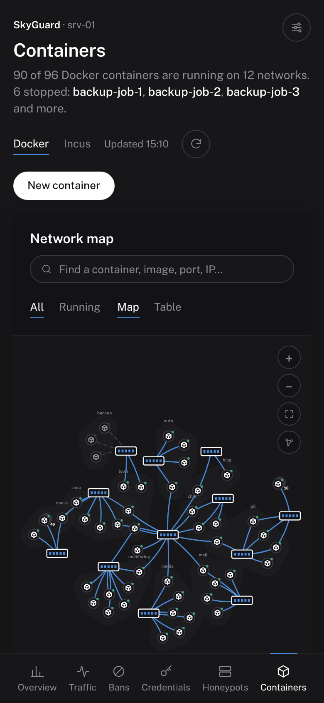</p>

---

## What is SkyGuard?

SkyGuard is a self-hosted, **zero-dependency** TCP security layer for Linux servers. Every incoming connection is intercepted, analysed, and routed based on a configurable decision engine:

- **Real services** (e.g. SSH) are hidden behind stealth ports — invisible to scanners, accessible only to clients sending the correct protocol signature.
- **Honeypot services** mimic common servers (SSH, FTP, MySQL, HTTP) to attract, log, and auto-ban attackers.
- **Passthrough services** forward traffic transparently to real backends while recording metadata.
- A **behavioural scoring engine** auto-bans IPs that exceed a configurable threat threshold via `iptables` or `ufw`.

All data is stored in a local **SQLite** database with a built-in **REST API + browser dashboard**.

---

## Traffic Decision Flow

```
Internet → Server (public IP) → SkyGuard (all ports)
                                       │
                    ┌──────────────────┼──────────────────┐
                    ▼                  ▼                   ▼
             Stealth Port        Honeypot Port      Passthrough Port
          (protocol check)     (fake + log + ban)   (analyse + proxy)
                    │
         ┌──────────┴──────────┐
         ▼                     ▼
   Correct signature       Wrong / no data
   → forward to real       → log & close
     service                 (no banner: nmap shows tcpwrapped)
```

**Per-connection pipeline:**

```
1. Whitelist (IP/CIDR, loopback always) → never scored or banned, routed directly
2. Active ban in DB     → drop, re-apply firewall rule
3. IP blacklist         → drop
4. GeoIP lookup         → stealth allowed_countries, country white/blacklist
5. Rate limit           → per-minute / per-hour exceeded? → drop + score
6. Port-scan detection  → N distinct ports in window? → drop + score (once per burst)
7. Honeypot routing     → score, log, capture credentials
8. Stealth detection    → protocol signature match? → forward : drop silently
9. Auto-ban             → score ≥ threshold → DB ban + iptables rule in the SKYGUARD chain
```

Bans are stored in SQLite and re-applied to the firewall at start-up; when a
temporary ban expires the kernel rule is removed and the IP's score is reset.
Passthrough services only apply steps 1–4 (real users must not be rate-limited).

---

## Features

| Category | Feature |
|---|---|
| 🕵️ **Stealth** | Real services hidden behind arbitrary ports; no banner is ever sent to non-matching clients |
| 🍯 **Honeypots** | SSH · FTP · MySQL · HTTP — configurable banners, individually toggled |
| 🔀 **Proxy** | Transparent TCP passthrough with connection logging |
| 📍 **GeoIP** | Country-level allow/block lists via MaxMind GeoLite2 |
| 📊 **Scoring** | Per-IP threat score; auto-ban on threshold breach |
| 🚫 **Auto-ban** | `iptables`/`ip6tables` (own `SKYGUARD` chain, legacy/nft auto-detected), `ufw` (bare metal), or dry-run (`none`) |
| 🔑 **Credentials** | Every username + password attempt harvested and ranked |
| ⏱️ **Rate limiting** | Per-IP sliding window (per-minute + per-hour) |
| 🛡️ **DoS guard** | Semaphore caps concurrent connections at 4 096 |
| 📦 **Storage** | Single-file SQLite, WAL mode, auto-purge old records |
| 🌐 **Dashboard** | Browser UI with live polling + JSON REST API |
| 🤖 **MCP** | A built-in Model Context Protocol server: Claude, ChatGPT, Cursor or any MCP client can read attacks, bans, credentials and containers, and act when you allow it |
| 🔒 **Port access** | Per-port rules for anything listening on the host (databases, admin panels, Docker and Incus ports): *only these sources* or *everyone except these*, IPv4 and IPv6, with a self-undoing trial on SSH and the dashboard |
| 🧩 **Containers** | Opt-in Docker and Incus management, switched on from the panel: a network map to wire containers together, create / start / stop / pause / remove, published ports, restart policy, limits, logs, Incus snapshots |
| 🐳 **Docker** | Multi-stage image (`golang:1.27` → `debian:trixie-slim` with iptables-legacy + iptables-nft), built-in health check |
| ⚙️ **Config** | Single YAML file; hot-toggleable services (`enabled: false`) |
| 0️⃣ **Zero deps** | CGO disabled — pure Go binary, no shared libraries |

---

## Installation

SkyGuard runs as one Docker container on the host's network (recommended), or as a plain binary under systemd. Three ways to get there, from the most guided to the most manual. **AI agents installing SkyGuard on a server: follow [LLM_INSTALL.md](LLM_INSTALL.md)**, which is written to be executed step by step with checks and stop conditions.

### Before you start

| | |
|---|---|
| **System** | 64-bit Linux (x86_64 or arm64): Ubuntu 20.04–24.04, Debian 11–12, Rocky / AlmaLinux / RHEL 8–9, Fedora 38+ (what `install.sh` supports; other distributions work with Option B or C). 1 vCPU and 256 MB of RAM are plenty. |
| **Access** | Root (`sudo`). SkyGuard binds ports below 1024 and manages iptables. |
| **Software** | Docker Engine with the compose plugin (the installer installs both), `git`. |
| **Your IP** | Know the public IP you administer the server from: it goes on the whitelist so auto-ban can never lock you out. `echo $SSH_CLIENT` on the server prints it as the first field. |
| **Ports** | SkyGuard wants the ports of the honeypots you enable (21, 80, 3306, 8080; 22 only if you move sshd), the stealth port (9911 by default) and 127.0.0.1:9090 for the dashboard. Check what is taken with `sudo ss -tlnp`. A reverse proxy that already holds 80/443 (Nginx Proxy Manager, Traefik, Caddy) is fine: see [sharing 80/443](#sharing-ports-80443-with-a-reverse-proxy-nginx-proxy-manager-traefik-caddy). |

> **Keep your current SSH session open until the end.** Test every change (especially the stealth port) from a *second* terminal. Nothing in the installer blocks port 22 unless you confirm it after the stealth port has been proven to reach your sshd.

### Option A — the interactive installer (recommended)

```bash
git clone https://github.com/SkyFetch0/SkyGuard.git
cd SkyGuard
sudo bash install.sh            # English
sudo bash install.sh --lang tr  # Türkçe
```

The wizard asks, in order: whether to whitelist the public IP it detects for you (say yes), extra whitelist IPs and blocked countries; the stealth SSH port and where the real sshd listens; which honeypots to run (a port that is already taken is detected and that honeypot left off, naming the owner, e.g. `docker container nginx-proxy-manager`); an HTTPS passthrough; GeoIP; auto-ban threshold, ban length and firewall backend; the dashboard user and password (empty generates one); Docker / Incus management; log retention. Then it:

1. installs Docker if missing and the packages it needs (`curl`, `iptables`, `sqlite3`, `iproute2`, and `iptables-persistent` or `iptables-services` so rules survive a reboot);
2. copies the project to `/opt/skyguard` and writes `/etc/skyguard/skyguard.yaml` (mode 600);
3. snapshots your iptables rules (for `uninstall.sh --restore-iptables`), creates the `SKYGUARD` chain, hooks it into `INPUT` and `DOCKER-USER`, and opens exactly the ports you chose (recorded in `/etc/skyguard/firewall.state`);
4. writes `/opt/skyguard/docker-compose.yml`, builds the image, validates the config with `skyguard -check-config`, starts the container and waits until it is healthy;
5. dials the stealth port itself and, only if your sshd answers through it, offers to block direct access to port 22;
6. installs `skyguard.service` (starts the compose project at boot), log rotation and a daily database backup.

When it finishes, open a **new** terminal and log in through the stealth port before you close the old one:

```bash
ssh -p 9911 you@your-server
```

### Option B — Docker Compose by hand

```bash
git clone https://github.com/SkyFetch0/SkyGuard.git /opt/skyguard
cd /opt/skyguard
cp configs/skyguard.example.yaml configs/skyguard.yaml   # must exist before `up`, or Docker creates a directory
chmod 600 configs/skyguard.yaml
$EDITOR configs/skyguard.yaml     # whitelist.ips, dashboard.auth.password, the honeypots you want
docker compose build
docker compose run --rm skyguard -check-config -config /etc/skyguard/skyguard.yaml
docker compose up -d
docker compose ps                 # wait for "(healthy)"
```

`docker-compose.yml` uses host networking and `NET_ADMIN`/`NET_RAW`, so honeypots see real client addresses and bans land in the host's firewall. Data (SQLite database, SSH honeypot host key, GeoIP database) lives in `./data`. To let the dashboard manage containers, uncomment the socket lines in `docker-compose.yml` (see [Containers](#containers-docker-and-incus)).

The example config enables `fake-http` on port 80; turn it off (or move it) if a web server or reverse proxy already uses 80, otherwise SkyGuard refuses to start and names the port.

### Option C — native binary with systemd

```bash
git clone https://github.com/SkyFetch0/SkyGuard.git && cd SkyGuard
make build                                   # Go 1.27+ (go.mod pins go1.27.3; GOTOOLCHAIN downloads it)
sudo install -m 755 bin/skyguard /usr/local/bin/skyguard
sudo mkdir -p /etc/skyguard /var/lib/skyguard
sudo install -m 600 configs/skyguard.example.yaml /etc/skyguard/skyguard.yaml
sudoedit /etc/skyguard/skyguard.yaml         # also set general.data_dir and logging.db_path to /var/lib/skyguard
sudo skyguard -check-config -config /etc/skyguard/skyguard.yaml
```

Then install the unit from [USAGE.md › Running as a systemd Service](USAGE.md#running-as-a-systemd-service) and `sudo systemctl enable --now skyguard`. The binary needs `iptables` (or `ufw`) on the host.

### Check that it works

| Check | Command | Expect |
|---|---|---|
| Container is healthy | `docker ps --filter name=skyguard` | `Up … (healthy)` |
| Liveness | `curl -fsS http://127.0.0.1:9090/healthz` | `ok` |
| Listeners | `docker logs skyguard 2>&1 \| grep "listener started"` | one line per enabled service |
| Stealth port reaches sshd | `timeout 5 bash -c 'exec 3<>/dev/tcp/127.0.0.1/9911; printf "SSH-2.0-check\r\n" >&3; head -c 8 <&3'` | `SSH-2.0-` |
| Stealth login | from a second terminal: `ssh -p 9911 you@server` | a normal login |
| Firewall | `sudo iptables -S SKYGUARD; sudo iptables -S DOCKER-USER` | the chain exists; `-A DOCKER-USER -j SKYGUARD` when Docker runs |
| Dashboard | `ssh -L 9090:127.0.0.1:9090 you@server -p 9911`, then open http://localhost:9090 | the login prompt, then the overview |

### Turn on container management

Open **Settings → Container engines** in the dashboard and switch Docker or Incus on. SkyGuard checks that the socket answers and that the dashboard password is strong. With Docker Compose, mount the socket into the container first (uncomment the lines in `docker-compose.yml`, then `docker compose up -d`). Details and safety notes: [Containers](#containers-docker-and-incus).

### Update

```bash
cd /opt/skyguard && git pull && docker compose build && docker compose up -d
```

The database, the config file and the honeypot host keys are kept. Dashboard choices (honeypot switches, auto-ban settings, container engines) survive until you change the same setting in the config file.

### Uninstall

```bash
sudo bash /opt/skyguard/uninstall.sh                     # stop, remove the container and SkyGuard's firewall rules
sudo bash /opt/skyguard/uninstall.sh --purge             # also delete /etc/skyguard and the data
sudo bash /opt/skyguard/uninstall.sh --restore-iptables  # put back the iptables snapshot taken before install
```

### When something goes wrong

| Symptom | Cause and fix |
|---|---|
| `listen :80: … address already in use (another process already listens on this port; check with: ss -tlnp)` | Another program or container has the port (`ss -tlnp` names it; Docker's shows as `docker-proxy`). Turn that honeypot off or give it another `port`, then restart. |
| `skyguard.yaml: is a directory` | `docker compose up` ran before `configs/skyguard.yaml` existed. `rm -r configs/skyguard.yaml`, copy the example, start again. |
| Locked out of SSH | From the provider's console: `iptables -D INPUT ! -i lo -p tcp --dport 22 -j DROP` and `iptables -F SKYGUARD`, then whitelist your IP. |
| Dashboard does not open from your PC | It listens on 127.0.0.1 only, on purpose. Use the SSH tunnel above. |
| Container stays `unhealthy` | `docker logs skyguard` names the problem; `docker compose run --rm skyguard -check-config -config /etc/skyguard/skyguard.yaml` validates the file. |

More in [USAGE.md › Troubleshooting](USAGE.md#10-troubleshooting).

---

## Configuration

Full annotated reference: [`configs/skyguard.example.yaml`](configs/skyguard.example.yaml)

### Stealth SSH — the killer feature

Real SSH stays on `127.0.0.1:22`. SkyGuard listens on port `9911` publicly. A scanner can see that the TCP port is open, but it never receives a banner (nmap reports `tcpwrapped`/unknown) because SkyGuard waits for the client to speak first. An SSH client connecting to `9911` sends `SSH-2.0-` as its first bytes — SkyGuard recognises the signature and proxies the connection transparently.

```yaml
stealth_services:
  - name: "ssh"
    enabled: true
    listen_port: 9911             # public port clients connect to
    real_target: "127.0.0.1:22"  # where sshd actually listens
    protocol_signature: "SSH-2.0-"
    timeout: "5s"                 # no matching signature → drop
    allowed_countries: ["TR","US"] # optional country allowlist
```

```
nmap -sV -p 9911 your-server  →  9911/tcp  open  tcpwrapped
ssh -p 9911 user@server     →  connected (transparent proxy)
```

### Honeypot services

Each honeypot can be toggled independently **without restarting** anything else — just set `enabled: false` and send `SIGHUP` (or restart the container):

```yaml
honeypot_services:
  - name: "fake-ssh"
    enabled: true          # ← toggle here
    port: 22
    type: "ssh"
    banner: "SSH-2.0-OpenSSH_8.9p1 Ubuntu-3ubuntu0.6"
    max_auth_attempts: 3

  - name: "fake-mysql"
    enabled: false         # disabled without removing config
    port: 3306
    type: "mysql"
    banner: "5.7.42-0ubuntu0.18.04.1"
```

### Auto-ban scoring

```yaml
analysis:
  auto_ban:
    enabled: true
    score_threshold: 50    # ban when score reaches this value
    ban_duration: "24h"
    method: "iptables"     # "iptables" | "ufw" | "none"
    scoring:
      honeypot_connection: 10
      failed_credential:   15
      port_scan_detected:  25   # 5+ distinct ports within 60 s
      blacklisted_country:  5
      rate_limit_exceeded: 20
```

### Key configuration reference

| Section | Field | Default | Description |
|---|---|---|---|
| `general` | `log_level` | `info` | `debug` · `info` · `warn` · `error` |
| `stealth_services[*]` | `listen_port` | — | Public port clients connect to |
| `stealth_services[*]` | `protocol_signature` | — | First-bytes prefix to forward on |
| `stealth_services[*]` | `timeout` | `10s` | Close if no signature arrives |
| `stealth_services[*]` | `allowed_countries` | `[]` | Requires GeoIP; private/LAN IPs are always allowed |
| `honeypot_services[*]` | `enabled` | `true` | Toggle per honeypot (restart required) |
| `honeypot_services[*]` | `type` | — | `ssh` · `ftp` · `mysql` · `http` |
| `analysis.auto_ban` | `score_threshold` | `100` | Score that triggers a ban |
| `analysis.auto_ban` | `ban_duration` | `24h` | `"1h"` · `"24h"` · `"7d"` · `"0s"` = permanent |
| `analysis.auto_ban` | `method` | `none` | `iptables` (recommended, also in Docker) · `ufw` (bare metal only) · `none` |
| `analysis.auto_ban` | `iptables_backend` | `auto` | `auto` · `legacy` · `nft` |
| `whitelist` / `blacklist` | `ips` | `[]` | Single IPs or CIDR ranges |
| `analysis.rate_limit` | `max_per_minute` | `20` | Connections per IP per minute |
| `dashboard` | `listen` | `127.0.0.1:9090` | Non-loopback binds require a strong password |
| `logging` | `retention_days` | `90` | Auto-purge records older than N days |

---

## Containers (Docker and Incus)

The dashboard can manage the containers that run next to SkyGuard: Docker,
and Incus (the community fork of LXD; system containers and virtual
machines). Both engines are spoken to directly over their unix sockets
(Docker Engine API, Incus REST API), so no CLI is needed inside SkyGuard's
container. Access to either socket is equivalent to root on the host, so it is
**off** until you switch it on, it requires a strong `dashboard.auth`
password, and `read_only: true` (config file only) limits it to listing.

Switch each engine on under **Settings → Container engines** (or with the
buttons on the empty Containers screen). SkyGuard checks that the socket
answers before it accepts, and remembers the choice across restarts; setting
`containers.docker.enabled` / `containers.incus.enabled` in the config file
works too, and once you change that value in the file, the file wins again.

```yaml
containers:
  read_only: false
  docker: { enabled: true, socket: /var/run/docker.sock }
  incus:  { enabled: false, socket: /var/lib/incus/unix.socket, project: "" }
```

With docker compose, mount the sockets you enable (`docker-compose.yml` has
the lines commented out; the installer adds them when you say yes):

```yaml
    volumes:
      - /var/run/docker.sock:/var/run/docker.sock
      - /var/lib/incus:/var/lib/incus:ro   # the directory: Incus recreates its socket on restart
```

What each change does:

| Change | Docker | Incus |
|---|---|---|
| Start / stop / restart | in place (10 s stop timeout) | in place (30 s) |
| Join / leave a network | `network connect` / `disconnect`, live | a `nic` device added / removed live (a profile's nic is masked with `type: none`) |
| Published ports | **recreates the container** (Docker cannot change ports in place): same image ID, config, labels, networks with aliases and static IPs, named and anonymous volumes; the old one is renamed aside and removed only after the new one starts, otherwise it is put back unchanged | proxy devices (`listen tcp:0.0.0.0:8080`, `connect tcp:127.0.0.1:80`) added / removed live |
| Restart policy | live (`no`, `on-failure`, `unless-stopped`, `always`) | `boot.autostart` (`no`, `last-state`, `always`) |
| Memory / CPU limit | set or raise live; removing one recreates the container | `limits.memory` / `limits.cpu`, live |
| Pause / resume | `pause` / `unpause` | `freeze` / `unfreeze` |
| Create | pulls the image if missing, then create and start | from `images:<distro>/<release>` (images.linuxcontainers.org) or a local alias; container or VM |
| Remove | stop and delete; named and anonymous volumes are kept | stop and delete with its snapshots; custom volumes are kept |
| Logs | the last stdout/stderr lines | the console log (or the LXC log) |
| Snapshots | — (Docker has none) | take, roll back, delete |

A port is refused before anything changes when another running container
publishes it, a SkyGuard listener (or the dashboard) holds it, or a program on
the host is bound to it. SkyGuard's own container is protected: it can be
listed but not stopped, restarted or re-ported from the panel. A container
that belongs to a Compose project gets its compose file's ports back on the
next `docker compose up`, so change those there too; the sheet says so.

**Bans cover container ports.** Traffic to a port Docker publishes is DNAT-ed
and crosses `FORWARD`, never `INPUT`, so a ban in `INPUT` alone let a banned IP
keep reaching every container. SkyGuard now also jumps to its `SKYGUARD` chain
from the top of `DOCKER-USER` (checked again on every ban, since Docker may
start later); `uninstall.sh` removes the jump. Incus proxy devices accept on
the host and are covered through `INPUT`. With `method: ufw` Docker's ports
are not covered (ufw never sees forwarded traffic); use `iptables`.

### Sharing ports 80/443 with a reverse proxy (Nginx Proxy Manager, Traefik, Caddy)

Only one process can listen on a port. If a reverse proxy container publishes
80 and 443, SkyGuard's `fake-http` honeypot (port 80) and an HTTPS
`passthrough` (port 443) cannot have them, and SkyGuard refuses to start with
the owner named (`address already in use`). The installer detects this and
leaves those listeners off. Pick one of:

1. **The proxy keeps 80/443 (recommended).** Disable `fake-http` or move it
   to a port nothing real uses (`port: 8081`), and leave the passthrough off.
   The *Host ports* table shows who holds what; bans still protect the proxy
   through `DOCKER-USER`.
2. **SkyGuard in front.** Publish the proxy on loopback only
   (`127.0.0.1:8080:80`, `127.0.0.1:8443:443`) and let SkyGuard forward with
   two `passthrough_services` (80 → `127.0.0.1:8080`, 443 →
   `127.0.0.1:8443`). Every connection is then logged, scored and bannable
   before it reaches the proxy, but the proxy sees `127.0.0.1` as the client
   address (TCP passthrough has no PROXY protocol), so its own access lists
   and logs lose the real IP. Change the ports from the container's sheet in
   the dashboard, or in its compose file.

SkyGuard's listeners bind every address (`:80`), so the proxy cannot keep
`127.0.0.1:80` either: in option 2 it moves to other ports.

## Port access rules

A server usually listens on more than its web ports: a database published by
a Compose file, Elasticsearch and Kibana, an admin panel, a game server.
`ss -tulnp` shows them; anything on `0.0.0.0` or `[::]` is open to the whole
internet unless something stops it. The **Ports** screen lists each of them
with what is behind it and lets you put a rule in front of it:

- **Only these sources**: the listed addresses and networks get in, everyone
  else is dropped. `private` stands for every internal range (10/8,
  172.16/12, 192.168/16, 100.64/10, fc00::/7, fe80::/10): containers, the
  LAN, Tailscale and other VPNs. An empty list means *this server only*.
- **Everyone except these**: the listed sources are dropped, the rest get in.

The server itself (loopback) always gets in, and so does `whitelist.ips` from
the config on every *only these* rule. Rules drop new connections only, so a
session that is already open is never cut. A port can be one number or a
range (`9200-9300`), TCP, UDP or both.

**What a rule covers.** Host programs (sshd, pure-ftpd, a MySQL installed
with apt), Incus proxy devices (the default kind; one with `nat=true` is
forwarded by Incus's own nftables rules and is not covered), and Docker's
published ports, which never
pass through INPUT: Docker forwards them, so the rules also sit in
`DOCKER-USER`, the place Docker keeps for this, and match the port as it is
published on the host (`-p 27017:27017` → rule for 27017), before Docker
rewrites it. Containers that talk to each other over a Docker network are
not affected, and neither are a container's own outbound connections. Both
IPv4 and IPv6 are covered (a `[::]:27017` listener is reached over IPv6 too).

**You cannot lock yourself out for good.** Port 22, any other port sshd
listens on (when SkyGuard can see the host's processes), the stealth ports and the dashboard's port are *protected*: a
change that restricts one of them is put in force at once, but saved only
when you press *Keep these rules*. If you don't within two minutes, because
the change cut your own connection, the previous rules come back by
themselves. The saved rules are applied again at every start, and checked
every minute: if a `firewalld` reload or an `iptables -F` removed them, they
are put back.

Under the hood: two chains, `SKYGUARD-PORTS` (jumped to from `INPUT`) and
`SKYGUARD-PORTS-FWD` (from `DOCKER-USER`), right after the ban chain, so a
ban still wins and a rule comes before the host's own ACCEPT rules. Each
rule's DROP carries the comment `sg:<id>`, which is where the *dropped*
counters come from:

```bash
sudo iptables -S SKYGUARD-PORTS
sudo iptables -L SKYGUARD-PORTS-FWD -n -v      # packet counts per rule
```

Port rules need `iptables` on the host (any backend, also when bans go
through `ufw` or `auto_ban.method: none`); without it the screen says so and
refuses changes. SkyGuard in Docker needs `network_mode: host` and
`NET_ADMIN`, which the shipped compose file already has; it then sees the
host's ports but not the programs behind them (those are named when SkyGuard
runs natively, or for containers once container management is on).

### Locking down a busy server

1. **Open the Ports screen** (*Reachable from outside*). Everything there is
   reachable from the internet; the yellow tags mark databases and admin
   interfaces that anyone can reach.
2. **Close what nobody outside needs at the source.** If only containers on
   the same server use a database, don't publish its port, or publish it on
   loopback only. In a Compose file:

   ```yaml
   ports:
     - "127.0.0.1:27017:27017"   # instead of "27017:27017"
   ```

   Other containers reach it over their shared network by service name
   (`mongodb://mongo:27017`), which needs no published port at all.
3. **Put a rule on what must stay reachable from somewhere.** For example
   MongoDB used by an app on another server and by your office:
   *Restrict…* on 27017 → *Only these sources* → `198.51.100.20`,
   `203.0.113.0/24`, `private`. For Elasticsearch and its cluster port, one
   rule for `9200-9300`.
4. **Leave public what is meant to be public** (80/443 of a reverse proxy, a
   game server). Use *Everyone except these* there to keep known abusers out
   of one service without banning them everywhere.
5. **SSH**: leave 22 to the stealth port and the honeypot. If you do restrict
   it, keep your own address in the list and press *Keep these rules*.
6. **Check from outside** (another machine): `nc -vz your-server 27017` now
   times out, and the rule's *dropped* counter goes up.

## AI assistants (MCP)

SkyGuard has a built-in [Model Context Protocol](https://modelcontextprotocol.io) server, so an AI assistant can answer "who attacked me last night?", "is anything on port 80 besides the reverse proxy?" or "ban the address that keeps trying root" from SkyGuard's own data. It is built on the official Go SDK and served at `/mcp` on the dashboard's address as stateless Streamable HTTP.

<p align="center">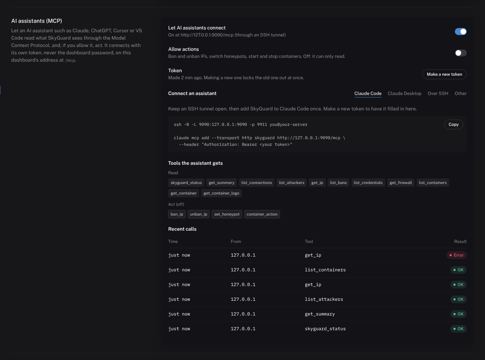</p>

**Turn it on:** Settings → *AI assistants (MCP)* → *Let AI assistants connect*. SkyGuard makes a token and shows it once; copy it. The panel then offers ready-to-paste setups with the token filled in:

- **Claude Code** (open the tunnel, then add the server once):
  ```bash
  ssh -N -L 9090:127.0.0.1:9090 -p 9911 you@your-server
  claude mcp add --transport http skyguard http://127.0.0.1:9090/mcp --header "Authorization: Bearer <token>"
  ```
- **Claude Desktop** and other stdio-only clients, through `mcp-remote` and the same tunnel:
  ```json
  {"mcpServers": {"skyguard": {"command": "npx", "args": ["-y", "mcp-remote", "http://127.0.0.1:9090/mcp", "--header", "Authorization:${SKYGUARD_AUTH}"],
    "env": {"SKYGUARD_AUTH": "Bearer <token>"}}}}
  ```
- **Over SSH, no tunnel:** the client starts SkyGuard's own stdio bridge on the server (`skyguard -mcp-stdio`):
  ```json
  {"mcpServers": {"skyguard": {"command": "ssh", "args": ["-p", "9911", "you@your-server",
    "docker", "exec", "-i", "-e", "SKYGUARD_MCP_TOKEN=<token>", "skyguard", "skyguard", "-mcp-stdio"]}}}
  ```
- **Anything else** that speaks Streamable HTTP: URL `http://127.0.0.1:9090/mcp`, header `Authorization: Bearer <token>`.

**Tools.** Reading is always available; the action tools exist only while *Allow actions* is on (off by default), so an assistant in read-only mode cannot even see them.

| Tool | What it does | |
|---|---|---|
| `skyguard_status` | Host, version, firewall backend and whether bans cover Docker's ports, auto-ban settings, totals, every service, container engines | read |
| `get_summary` | One window (24h / 7d / 30d) against the one before: counters, where connections ended, busiest sources, services, countries, ports | read |
| `list_connections` | The connection log, filtered by IP, country, service, outcome, last N hours | read |
| `list_attackers` | IPs by threat score with counters, ports and ban state | read |
| `get_ip` | One address: score, ban, whitelist, latest connections and logins | read |
| `list_bans` | Active bans and when they lift | read |
| `list_credentials` | Most tried usernames, passwords and pairs | read |
| `get_firewall` | The SKYGUARD chain's rules and Docker coverage | read |
| `list_ports` | Every listening port with its owner, reach and risk, and the port access rules with their drop counts | read |
| `list_containers` / `get_container` / `get_container_logs` | Containers, networks, port conflicts; one container; its last log lines | read |
| `ban_ip` / `unban_ip` | Ban for a duration (default 24h, `0` permanent) or lift a ban | action |
| `set_honeypot` | Open or close a honeypot's port | action |
| `container_action` | Start, stop, restart, pause or resume a container | action |

Deliberately not offered to an assistant: removing or creating containers, changing ports, network wiring, and SkyGuard's own settings.

**Safety model.**
- The token is separate from the dashboard password and stored only as a SHA-256 hash. *Make a new token* locks the old one out at once; switching MCP off answers every call with 404.
- Wrong tokens are throttled per address (the same rule as the dashboard login), and all clients together are limited to about 240 calls a minute.
- Browsers cannot drive the endpoint: cross-site requests and DNS-rebinding attempts (a loopback connection with a foreign `Host`) are refused with 403.
- Bans requested over MCP go through the same rules as the dashboard: whitelisted and loopback addresses are refused. SkyGuard's own container cannot be stopped.
- Attacker-supplied text is trimmed. The server's instructions and the tool descriptions tell the model that this text, and container logs, are data and never instructions (a defence against prompt injection through, say, a crafted HTTP path).
- Every call is shown under *Recent calls* with its client address and result, and action calls are logged.

## Dashboard & REST API

Access the dashboard via an SSH tunnel (never expose it directly):

```bash
ssh -L 9090:127.0.0.1:9090 user@your-server
# → http://localhost:9090
```

**Screens** (dark "data terminal" design, every figure in IBM Plex Mono so digits line up; fonts are embedded, nothing is loaded from the internet):

- **Overview** — the busiest source and whether it is banned, KPIs that switch the main chart (connections, honeypot hits, logins tried, dropped) over 24 h / 7 d / 30 d with the change against the previous period, a *decision flow* showing where every connection ended (trapped, let through, or dropped by ban, blacklist, rate limit, port scan, stealth probe), busiest sources with a one-click ban, targeted services and countries (or ports without GeoIP), latest events.
- **Connections** — a day × hour heatmap of the last 7 days in your local time, filters (IP, service, country, outcome) kept in the URL, paging, CSV export.
- **Attackers and bans** — threat scores against the auto-ban threshold, active bans with confirmed unban, ban reasons, a ban dialog (1 h / 1 day / 7 days / permanent).
- **Captured credentials** — most tried usernames and passwords, attempts per honeypot and over time, the most frequent pairs.
- **Honeypots and services** — switch each honeypot on or off at runtime (the listener opens or closes at once; the choice survives restarts until you change that honeypot in the config file), with 24-hour activity per service. Stealth and passthrough services are shown read-only: turning them off from a panel you usually reach through them could cut your own session.
- **Containers** (opt-in, see [Containers](#containers-docker-and-incus)) — a *network map* in the manner of a network simulator: networks are switches, containers are devices, memberships are cables. Select a container and pull a cable from its plug: drop it on a switch to join that network, or on another container to give the two a network in common (join one of the other's, or a new one for the pair); clicking *Connect…* and then the target works too. Click a cable to unplug it. Built to stay readable with a hundred containers: a force layout that keeps each Compose project together on a soft outline, numbered replicas (`queue-worker-1…40`) folded into one stacked device until you expand them, labels that give way to each other as you zoom out, search that dims everything else and brings the first match into view, a minimap, focus on a node's own cables when selected, and dragged positions remembered per browser. A *Table* view keeps the patch bay for precise work. *New container* pulls an image (Docker) or downloads one from images.linuxcontainers.org (Incus) and starts it with ports, network, environment, restart policy and limits. The side sheet starts, stops, restarts, pauses and removes; edits ports, restart policy and memory/CPU limits; shows the last 200 log lines; and for Incus takes, rolls back and deletes snapshots. A host-port table names whoever holds each port (SkyGuard listeners included) and flags conflicts; *Open to the internet* lists every container port bound on all addresses and whether a ban stops traffic there.
- **Ports and access** — every port that takes connections on the host, who is behind it (program, container, SkyGuard service) and whether the internet can reach it, with databases and admin panels that anyone can reach flagged; the access rules with their drop counters, a rule editor, and the trial banner that undoes a change to SSH or the dashboard unless you keep it. See [Port access rules](#port-access-rules).
- **Auto-ban and firewall** — switch, threshold stepper, ban length, and the SKYGUARD chain's current rules.
- **IP detail** — a side sheet with score, daily activity, credentials and connections for any address.

Works on phones (bottom navigation) and with the keyboard; screen state lives in the URL hash, so every view can be bookmarked.

All endpoints except `/healthz` require HTTP Basic Auth (`dashboard.auth`).
Failed logins are throttled per client IP. JSON fields are `snake_case`.
State-changing `POST` endpoints require the header `X-SkyGuard-Request: 1` (CSRF protection).

| Method | Endpoint | Description |
|---|---|---|
| `GET` | `/healthz` | Unauthenticated liveness probe (Docker health check) |
| `GET` | `/api/info` | Host name, version, firewall backend, auto-ban state |
| `GET` | `/api/stats` | All-time totals, today, unique IPs/countries, credentials, active bans |
| `GET` | `/api/summary?range=24h\|7d\|30d` | This and the previous period, decision-flow outcomes, top sources, services, countries, ports |
| `GET` | `/api/series?range=…&ip=…&port=…` | Hourly (24 h, 7 d) or daily (30 d) counts incl. credentials, optionally for one IP or port |
| `GET` | `/api/credentials/breakdown?range=…` | Most tried usernames, passwords and attempts per honeypot |
| `GET` | `/api/services` | Every configured service with its state and 24 h activity |
| `POST` | `/api/services` | `name`, `enabled` — switch a honeypot at runtime |
| `GET` | `/api/timeline?hours=N` | Per-hour counts (gaps filled with zeros) |
| `GET` | `/api/connections` | Connection log; filters `ip`, `country`, `service`, `action`, `since`, `until` (RFC3339), `limit`, `offset` |
| `GET` | `/api/export` | Same filters, CSV download (formula-injection safe) |
| `GET` | `/api/attackers?limit=N` | IPs ranked by threat score, with touched ports |
| `GET` | `/api/credentials?limit=N` | Most-attempted service/username/password combinations |
| `GET` | `/api/banned` | Active bans with expiry timestamps |
| `GET` | `/api/ip?ip=X` | Score, ban state, recent connections and credentials of one IP |
| `GET` | `/api/firewall` | Firewall backend and SKYGUARD chain rules |
| `GET`/`POST` | `/api/settings` | Auto-ban settings (partial updates) |
| `POST` | `/api/ban` | `ip`, `duration` (`24h`, `7d`, `0` = permanent), `permanent`, `reason` — whitelisted IPs are refused |
| `POST` | `/api/unban` | `ip` — also resets the IP's score |
| `GET` | `/api/ports` | Listening ports (`listeners`), the access rules with `dropped` counts, `protected` ports, a running trial (`unsaved`, `trial_deadline`), `always_allowed`, `client_ip` |
| `POST` | `/api/ports` | `rules` — the whole rule list as JSON (`id`, `name`, `ports` `27017` or `9200-9300`, `proto` `tcp`/`udp`/`both`, `mode` `allow`/`deny`, `sources`, `enabled`); returns `trial` and its `deadline` when a protected port changed |
| `POST` | `/api/ports/confirm` | Keep the rules of a running trial |
| `POST` | `/api/ports/revert` | End a running trial now and bring the saved rules back |
| `GET` | `/api/containers` | `enabled`, engines and their state, containers, networks, `host_ports` (every claimant per port, conflicts first), `ban_coverage` |
| `GET` | `/api/containers/inspect?engine=&id=` | One container with restart policy, limits, mounts |
| `POST` | `/api/containers/action` | `engine`, `id`, `action` = `start` \| `stop` \| `restart` |
| `POST` | `/api/containers/connect` | `engine`, `id`, `network`, `create=1` to create the network first |
| `POST` | `/api/containers/disconnect` | `engine`, `id`, `network` |
| `POST` | `/api/containers/ports` | `engine`, `id`, `ports` in `docker run -p` form, comma separated (`8080:80,127.0.0.1:8443:443/tcp`); empty unpublishes all |
| `POST` | `/api/containers/settings` | `engine`, `id`, `restart`, `memory_mb`, `cpus` (0 removes a limit) |
| `POST` | `/api/containers/networks` | `engine`, `name` — create a bridge network |
| `POST` | `/api/containers/networks/delete` | `engine`, `name` — delete a network nothing is on |
| `POST` | `/api/containers/engines` | `engine`, `enabled` — switch Docker or Incus management from the panel |
| `POST` | `/api/containers/create` | `engine`, `name`, `image`, `ports`, `network`, `env` (KEY=value lines, Docker), `restart`, `memory_mb`, `cpus`, `vm` (Incus), `start` |
| `POST` | `/api/containers/remove` | `engine`, `id` — stop and delete; volumes are kept |
| `GET` | `/api/containers/logs?engine=&id=&lines=200` | The last lines of stdout/stderr (Docker) or the console log (Incus) |
| `GET`/`POST` | `/api/containers/snapshots` | Incus: list; `action` = `take` \| `restore` \| `delete`, `name` |
| `GET` | `/api/mcp` | MCP state: `enabled`, `allow_actions`, `token_set`, `token_created`, `tools`, recent `activity` |
| `POST` | `/api/mcp` | `enabled`, `allow_actions`; switching on the first time returns a new `token` once |
| `POST` | `/api/mcp/token` | Make a new token (returned once); the old one stops working |
| `POST` | `/mcp` | The MCP endpoint itself: `Authorization: Bearer <token>`, not Basic Auth |

```bash
curl -u admin:password http://localhost:9090/api/stats
curl -u admin:password -H 'X-SkyGuard-Request: 1' -d ip=203.0.113.5 -d duration=7d \
     http://localhost:9090/api/ban
```

---

## Project Structure

```
SkyGuard/
├── cmd/skyguard/            # entry point: flags, graceful shutdown, health check probe
├── internal/
│   ├── config/              # YAML parsing, defaults and validation
│   ├── server/              # listeners, the connection pipeline, runtime honeypot switches
│   ├── stealth/             # protocol-aware forwarding to the hidden real service
│   ├── honeypot/            # SSH (x/crypto/ssh) · FTP · MySQL · HTTP
│   ├── proxy/               # bidirectional TCP proxy
│   ├── analysis/            # GeoIP · rate limiter · scorer · port-scan detector
│   ├── firewall/            # iptables / ip6tables (SKYGUARD chain, DOCKER-USER hook) · ufw · none
│   ├── containers/          # Docker Engine API and Incus REST API clients, the container manager
│   ├── storage/             # SQLite (pure Go): connections, credentials, bans, scores, settings
│   ├── netutil/             # IP normalisation, IP/CIDR sets
│   └── dashboard/           # HTTP server, REST API, MCP server (mcp.go), embedded UI (static/index.html, assets/*.js, *.css, fonts)
├── configs/skyguard.example.yaml
├── docs/                    # logo and screenshots
├── scripts/                 # install-plugin.sh, enable-ssh-honeypot.sh
├── install.sh / uninstall.sh
├── Dockerfile               # golang:1.27 → debian:trixie-slim
├── docker-compose.yml
├── Makefile
├── USAGE.md                 # full operational guide
└── LLM_INSTALL.md           # step-by-step install guide for AI agents
```

---

## Security Notes

> SkyGuard is a **detection and logging** layer. It complements — but does not replace — a properly configured host firewall and a patched OS.

- **Container management is root on the host.** Enable `containers.docker` / `containers.incus` only with a strong dashboard password, keep the dashboard on loopback, and prefer `read_only: true` if you only want to look.
- **An AI assistant with actions allowed can ban and stop things.** Leave *Allow actions* off unless you want that, and make a new MCP token if one may have leaked.
- **Never expose the dashboard publicly.** It binds to `127.0.0.1` by default. Use an SSH tunnel or an mTLS reverse proxy.
- **Add your own IP to `whitelist.ips`** before enabling auto-ban — you can lock yourself out.
- **Rotate the default password.** The example config ships with `CHANGE_ME_NOW`.
- **Secure the config file.** It contains credentials: `chmod 600 /etc/skyguard/skyguard.yaml`.
- **The stealth port is a secret.** Share it only over a secure channel. If an attacker learns it, the model is compromised.
- **GeoIP is advisory.** Determined attackers use VPNs. Pair it with score-based auto-ban.
- **SkyGuard stopping closes its ports.** Keep a whitelist-based `iptables` rescue rule for your own IP independent of SkyGuard, and keep port 22 reachable until you have verified the stealth port works (the installer only blocks 22 after testing it).

---

## Development

### Prerequisites

- **Go 1.27+** (CGO not required — `modernc.org/sqlite` is pure Go)
- **Docker** — for container builds and integration tests
- **make**

### Make targets

```
make build          Build binary  →  ./bin/skyguard
make run            Run with example config (localhost only)
make docker-build   Build Docker image
make docker-up      docker compose up -d
make docker-down    docker compose down
make test           go test ./...
make lint           golangci-lint run
make clean          Remove build artefacts
```

### Running tests manually

```bash
# Unit tests
go test ./...

# Race detector
go test -race ./...

# Vet
go vet ./...

# Quick smoke test with Docker
docker build -t skyguard:dev .
# (the dashboard binds 127.0.0.1, so use host networking, not -p)
docker run --rm --network host --cap-add NET_ADMIN \
  -v $(pwd)/configs/skyguard.example.yaml:/etc/skyguard/skyguard.yaml:ro \
  -v $(pwd)/data:/data \
  skyguard:dev
curl -u admin:CHANGE_ME_NOW http://localhost:9090/api/stats
```

### Environment variables

| Variable | Default | Description |
|---|---|---|
| `SKYGUARD_CONFIG` | `/etc/skyguard/skyguard.yaml` | Config file path (used when `-config` is not given) |
| `SKYGUARD_MCP_TOKEN` | — | The MCP token, for `-mcp-stdio` |
| `SKYGUARD_MCP_URL` | from `dashboard.listen` | The MCP endpoint `-mcp-stdio` relays to |

### Command-line flags

| Flag | Description |
|---|---|
| `-config PATH` | Config file |
| `-check-config` | Validate the config (ports, addresses, durations, CIDRs) and exit |
| `-healthcheck` | Probe the running instance's `/healthz` (used by Docker) |
| `-version` | Print the version |
| `-mcp-stdio` | Relay MCP between stdin/stdout and the running instance's `/mcp` (for stdio-only clients) |
| `-mcp-token-file PATH` | Read the MCP token for `-mcp-stdio` from a file instead of `SKYGUARD_MCP_TOKEN` |

---

## Roadmap

- [ ] Fake interactive shell for SSH honeypot (`fake_shell` is accepted but ignored)
- [ ] Notifications (Telegram, ntfy, Discord, e-mail, webhooks) for bans and honeypot logins
- [ ] Longer bans for repeat offenders
- [ ] Scheduled blocklist import (Spamhaus DROP, FireHOL level1) and nftables sets
- [ ] CrowdSec bouncer integration
- [ ] Reading sshd and reverse-proxy (Nginx Proxy Manager) logs
- [ ] HTTP lures for `/.git/config`, `/.env` and LLM API paths
- [ ] Vulnerability scan of container images (Trivy)
- [ ] TOTP two-factor login for the dashboard
- [ ] Prometheus metrics endpoint (`/metrics`)
- [ ] WebSocket / SSE live-push for the dashboard

---

## Contributing

Pull requests are welcome. For major changes please open an issue first to discuss the approach.

1. Fork the repository
2. Create a feature branch (`git checkout -b feature/my-feature`)
3. Commit your changes (`git commit -m 'add my feature'`)
4. Push to the branch (`git push origin feature/my-feature`)
5. Open a Pull Request

Please run `make lint` and `make test` before submitting.

---

## License

MIT © SkyGuard contributors

---

<div align="center">
<sub>Built with Go · Deployed with Docker · Runs on Linux</sub>
</div>